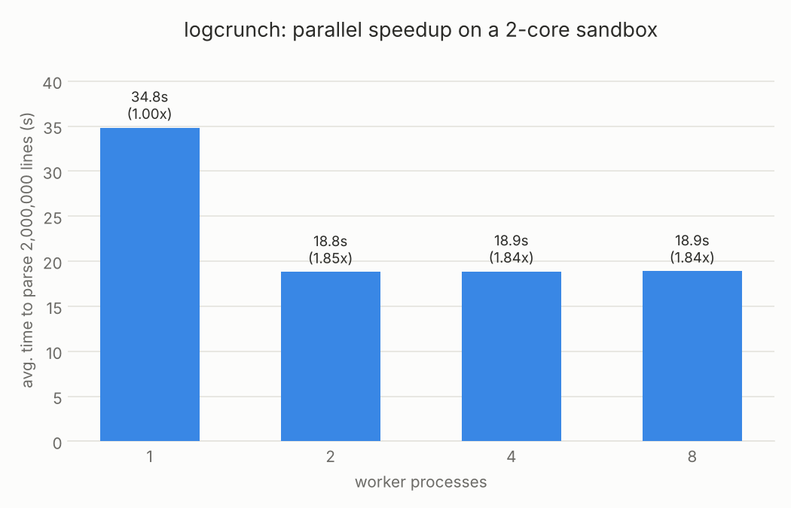

[logcrunch_README.md](https://github.com/user-attachments/files/33948521/logcrunch_README.md)
# logcrunch

A parallel command-line tool that parses and analyzes Apache-style error
logs: level counts, hourly volume, recurring message "templates," and
statistical anomaly (error-burst) detection — using `multiprocessing` to
split large files across worker processes. Built as a software engineering project covering packaging, CLI design,
concurrency and testing.

## Why this project

I wanted a project that goes beyond a web app, so I built a small, real
installable CLI tool that touches a different set of fundamentals — file I/O at scale, correct concurrent
processing (not just "it runs faster," but "it runs faster and still gives
the exact same answer"), and command-line tool design.

## What it does

```
$ logcrunch data_real/Apache_2k.log --workers 2
Lines parsed:     2,000
Hours covered:    34

Level counts:
  notice     1,405
  error      595

Top 6 message templates:
     836  jk2_init() Found child <NUM> in scoreboard slot <NUM>
     569  workerEnv.init() ok /etc/httpd/conf/workers2.properties
     539  mod_jk child workerEnv in error state <NUM>
      32  [client <NUM>.<NUM>.<NUM>.<NUM>] Directory index forbidden by rule: /var/www/html/
      12  jk2_init() Can't find child <NUM> in scoreboard
      12  mod_jk child init <NUM> -<NUM>

Anomalous hours (error bursts, z >= 2.0):
  2005-12-04 06:00  count=90  z=3.75
```

- **Parsing** (`src/logcrunch/parser.py`): regex + `datetime` parsing of the
  real Apache error-log format, with a `ParseError` for malformed lines
  rather than silently dropping them.
- **Templating** (`templater.py`): collapses numeric/hex IDs in a message
  (`"child 32710"` → `"child <NUM>"`) so repeated event types group
  together — a simplified version of the log-template-mining idea behind
  real tools like [Drain](https://github.com/logpai/Drain3).
- **Aggregation** (`aggregator.py`): level counts, hourly volume, top
  templates, and burst detection via a z-score over hourly error counts
  (an hour is "anomalous" if its error count is a statistical outlier
  relative to the rest of the file).
- **Parallelism** (`parallel.py`): splits the file into byte-range chunks
  *aligned to line boundaries* (never cutting a line in half), processes
  each chunk in a worker process via `multiprocessing.Pool`, and merges the
  per-chunk results. `tests/test_parallel.py` proves the parallel result is
  byte-for-byte identical to the serial result on real data, for 2, 3, 4,
  and 8 workers.
- **CLI** (`cli.py`): `argparse`-based, with `--workers`, `--format
  text|json`, `--top-n`, `--anomaly-level`, and `--timing`.

## Install & run

```bash
git clone https://github.com/talha-linx/logcrunch.git
cd logcrunch
pip install -e .          # installs the `logcrunch` command (editable install)

logcrunch data_real/Apache_2k.log --workers 2
logcrunch data_real/Apache_2k.log --format json --top-n 5
```

No install needed to just run it locally: `python -m logcrunch <file>` from
inside `src/` works the same way (this is how the test suite runs it, too).

## Tests

23 tests, `unittest` + stdlib only (no pytest):

```bash
PYTHONPATH=src python -m unittest discover -s tests -v
```

Covers parsing (including against the real, unmodified 2,000-line sample),
message templating, aggregation + merge correctness, chunk-boundary
correctness (no gaps, no overlaps, every chunk starts at a line boundary),
serial-vs-parallel equivalence on real data, and the CLI end to end
(including a missing-file error path).

## The real data

`data_real/Apache_2k.log` is a real, unmodified 2,000-line sample from a
production Apache HTTP Server error log, from the
[loghub](https://github.com/logpai/loghub) research collection of system
logs (citation in `data_real/SOURCE_README.md`). All correctness testing
and the example output above run against this real file.

## The benchmark (honest about what's synthetic)

A 2,000-line file is too small to show a meaningful serial-vs-parallel time
difference — most of the "work" would be process start-up, not parsing. To
actually measure parallel speedup, `benchmark/generate_synthetic_log.py`
generates a 2,000,000-line file in the same format (realistic level mix and
message templates, two injected error bursts to test anomaly detection at
scale). This file is clearly synthetic and is used **only** to benchmark
performance — never as a source of "findings" about real servers.

Measured results on this project's 2-core sandbox (`benchmark/run_benchmark.py`,
averaged over 2 runs each, real numbers — reproduce with the commands below):

| workers | avg time (2M lines) | speedup |
|---|---|---|
| 1 | 34.8s | 1.00x |
| 2 | 18.8s | 1.85x |
| 4 | 18.9s | 1.84x |
| 8 | 18.9s | 1.84x |



Speedup saturates right around 1.85x at 2 workers and doesn't improve past
that — expected, since the sandbox only has 2 CPU cores and this is
CPU-bound work (regex parsing), so throwing more worker *processes* at a
2-core machine just adds scheduling overhead without more real parallelism.
On a machine with more cores, the same code would be expected to keep
scaling up to roughly the core count, since each chunk is processed fully
independently with no shared state until the final merge.

The anomaly detector also correctly flagged both of the hours the
generator deliberately injected a burst into (out of 1,945 total hours in
the file), at very high z-scores (23.97 and 24.76), alongside one
borderline natural outlier (z=2.15) — the small false-positive rate you'd
expect from a z-score threshold at that scale.

Reproduce it:
```bash
python benchmark/generate_synthetic_log.py --lines 2000000
python benchmark/run_benchmark.py
python benchmark/plot_benchmark.py
```
